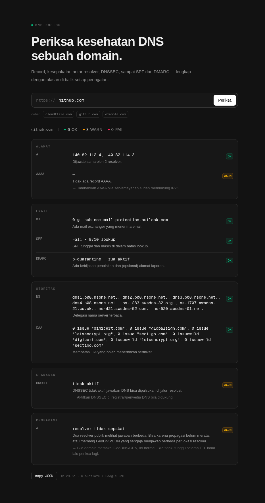

# dns.doctor

[](https://github.com/Avalntinus/dns-doctor/actions/workflows/ci.yml)

**Live:** https://dns-doctor-vavall1564-4387.vercel.app

Periksa kesehatan DNS sebuah domain dalam satu halaman: record apa yang ada,
apakah dua resolver publik sepakat, DNSSEC aktif atau tidak, dan apakah
konfigurasi email (SPF/DMARC) sudah benar — lengkap dengan alasan di balik
setiap peringatan, bukan cuma lampu merah.



```
cloudflare.com
  A        104.16.132.229, 104.16.133.229        OK
  AAAA     2606:4700::6810:84e5                  OK
  MX       10 mxa.global.inbound...              OK
  SPF      -all · 6/10 lookup                    OK
  DMARC    p=reject · rua aktif                  OK
  DNSSEC   AD flag                               OK
  Propagasi semua record konsisten               OK
```

## Yang diperiksa

| Grup | Item | Dasar penilaian |
|---|---|---|
| Alamat | A, AAAA | ada/tidak, CNAME terdeteksi |
| Email | MX, SPF, DMARC | null MX, duplikat SPF, batas 10 lookup, `+all`, `p=none`, `pct<100` |
| Otoritas | NS, CAA | delegasi terbaca, pembatasan CA |
| Keamanan | DNSSEC | flag `AD` dari resolver |
| Propagasi | A/AAAA/MX/TXT/NS/CAA/DMARC | jawaban berbeda antar resolver (GeoDNS/CDN ikut dijelaskan) |

## Cara kerja

```
browser  ──►  /api/lookup?domain=…       (Next.js Route Handler)
                    │
                    ├─► Cloudflare DoH (JSON)
                    └─► Google DoH (JSON)
                          │
                          ▼
                  lib/verdict.js  →  findings + alasan
```

Logika penilaian sengaja dipisah dari UI dan dari jaringan, sehingga bisa diuji
tanpa internet dan tanpa browser.

## Menjalankan

```bash
pnpm install
pnpm dev        # http://localhost:3000
pnpm test       # 71 tes, offline
pnpm lint
pnpm build
```

Butuh Node 22+ dan pnpm.

## Keputusan desain

- **JavaScript + JSDoc, bukan TypeScript.** Tidak ada langkah kompilasi; tipe
  ditulis sebagai komentar dan diperiksa editor lewat `checkJs`.
- **Dua resolver, bukan lima.** Cukup untuk mendeteksi ketidaksepakatan, dan
  menjaga beban ke resolver publik tetap wajar.
- **Tidak membandingkan TTL antar resolver.** Selisih TTL itu normal karena
  cache tiap resolver bergeser; membandingkannya menghasilkan false positive.
  Yang dibandingkan hanya isi jawabannya.
- **TXT dinormalisasi sebelum dibandingkan.** Cloudflare menjawab dengan tanda
  kutip, Google tanpa — tanpa normalisasi record yang sama terlihat berbeda.
- **Cache 5 menit per instance.** Di serverless ini best-effort, bukan jaminan.
- **Rate limit 20 permintaan/menit per IP** untuk melindungi resolver publik.

## Batasan

- Satu domain per permintaan; tidak ada pemeriksaan massal atau enumerasi
  subdomain.
- DKIM hanya dicek keberadaan record per selector; tanda tangan kriptografis
  tidak diverifikasi.
- Hanya resolver JSON (Cloudflare, Google). Quad9/AdGuard memakai format wire.
- Cache hilang saat cold start.

## Stack

Next.js 16 (App Router) · React 19 · Tailwind CSS 4 · Zod · Vitest

## Lisensi

MIT
